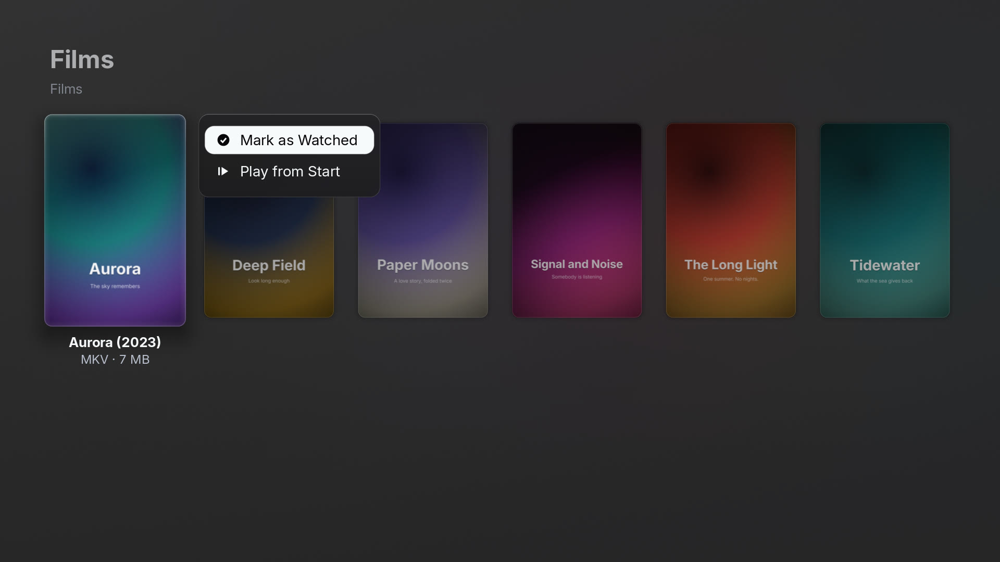
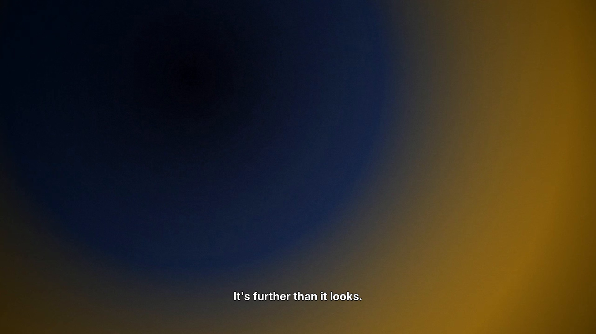

# PiTV

A lightweight 4K player for the films and shows in your own folders — on the machine's disk or on
an SMB share mounted from a NAS — built for the living room: a Raspberry Pi 5 under the TV, driven
by a remote or the arrow keys. 4K HEVC and H.264 in MKV or MP4, lossless audio, styled subtitles.

The interface is drawn straight on the GPU, and video is decoded by the machine's own GStreamer
(the Pi 5's V4L2 HEVC decoder; VA-API on a PC) and composited under the UI.


## What it does

- **Your library, from folders.** Point it at directories of films and shows — local, or SMB shares
  mounted with `cifs` (e.g. an `/etc/fstab` entry) — and it lists them with their posters and
  remembers where you stopped in each file.
- **Kodi-style audio and subtitle choices per file.** Pick the audio track, the subtitle (embedded,
  or a `.srt`/`.ass` beside the video) and its timing; the choice is remembered for that file.
- **Lossless audio.** DTS-HD Master Audio, TrueHD, FLAC, Opus, E-AC-3, AC-3, AAC, MP3 and PCM, at
  the track's own channel count.
- **Styled subtitles.** ASS/SSA through libass, with the file's own fonts; image subtitles (PGS,
  VobSub) too.

| | |
|---|---|
|  |  |
|  |  |
|  |  |

The screenshots show the demo library below; its artwork is credited in
[design/screenshots/linux/CREDITS.md](design/screenshots/linux/CREDITS.md).

## Building

Linux only. You need a nightly Rust toolchain, a C compiler, SDL2 and SDL2_ttf, and GStreamer with
its base, good, bad and libav plugin sets. On Debian, Ubuntu or Raspberry Pi OS:

```sh
sudo apt install build-essential pkg-config cmake nasm curl libsdl2-dev libsdl2-ttf-dev \
    libgstreamer1.0-dev libgstreamer-plugins-base1.0-dev \
    gstreamer1.0-plugins-good gstreamer1.0-plugins-bad gstreamer1.0-libav
rustup toolchain install nightly
```

Then:

```sh
make             # builds the app into dist/linux/pitv (FFmpeg and libass the first time)
make check       # the test suite
```

The first `make` also builds the pinned FFmpeg and libass under `vendor/` and bundles them beside
the binary. `dist/linux/pitv` is self-contained apart from the system libraries above: copy it
anywhere and run `pitv` from it.

## Running

```sh
dist/linux/pitv/pitv                     # the library: ~/Videos
PITV_MEDIA_DIRS=/srv/films:/srv/tv dist/linux/pitv/pitv   # other folders, ':'-separated
dist/linux/pitv/pitv /path/to/film.mkv   # play one file
PITV_FULLSCREEN=0 dist/linux/pitv/pitv   # a window instead of the whole screen
```

Arrows move, Enter is OK, holding Enter opens a title's menu (play from the start, mark as
watched), and Escape (or Q) goes back. In the player, OK pauses and resumes, Left and Right seek,
and Up reaches the subtitle and audio buttons; a remote's media keys work too. Logs and the per-file progress live in `~/.local/state/pitv`.

## Demo library

`design/demo-library/build.py` builds a library from PlxNative's openly licensed demo catalog:
Blender Studio's open films (Sintel, Spring, Big Buck Bunny, Sprite Fright, ...), public-domain
classics (Nosferatu, Metropolis, The General, ...) and two shows (Caminandes, ESA's Hubblecast).
Every source it needs is committed under `design/demo-library/sources/`, so nothing is
downloaded: the posters, backdrops and stills, and Sintel itself (282 MB, stored as three parts to
stay under GitHub's file-size limit). It cuts them to PiTV's folder layout and writes a
`CREDITS.md` with each one's licence and attribution. Sintel is the real film (`--no-films` leaves
it out); every other title gets a short clip panning across its own key art, with its synopsis as
an English subtitle file.

```sh
design/demo-library/build.py             # into design/demo-library/library (not committed)
PITV_MEDIA_DIRS=design/demo-library/library dist/linux/pitv/pitv
```

The catalog is `design/demo-library/catalog.json`; `assets.json` pins every source (URL, hash,
licence, author, attribution). Where Wikimedia refused a bulk download of the original, the stored
file is its standard 1280-pixel thumbnail, pinned in the asset's `file` entry.
`design/demo-library/generate.sh` makes a much smaller library of invented titles from nothing but
`ffmpeg`.

## Status

PiTV began as a fork of PlxNative, a Plex client for LG televisions. The Plex client, its screens
and the LG webOS port are gone; internal crate names still carry the old `plx` prefix. The
interface is English only. Developer notes are in [AGENTS.md](AGENTS.md).

## Licence

GPL-3.0-or-later. See [LICENSE](LICENSE) and [NOTICE.md](NOTICE.md).
