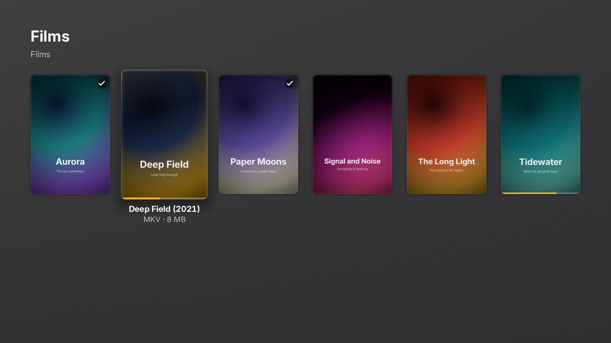
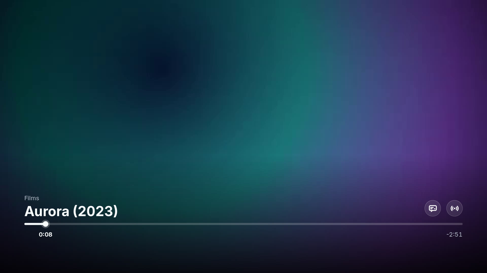
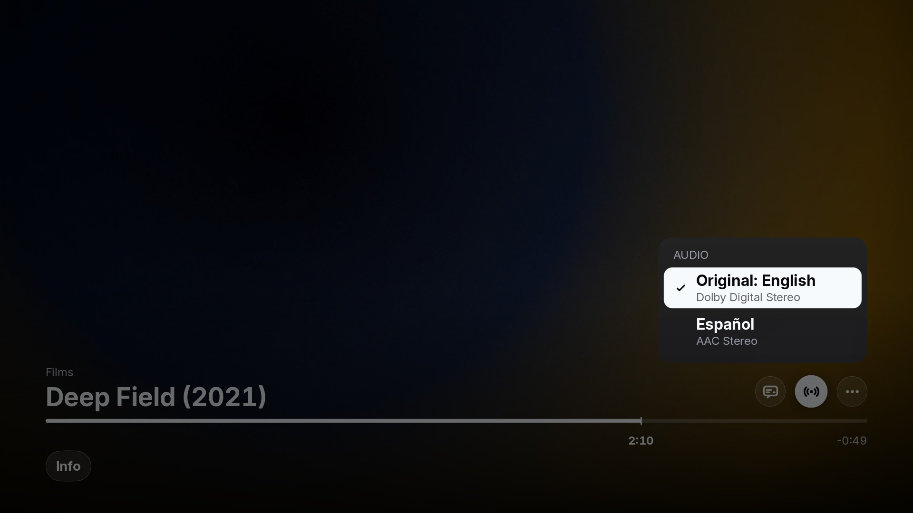
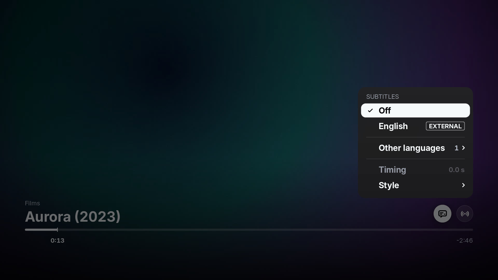

# PiTV

A native media player for the folders of films and shows on your own disk, built for the living
room: a Raspberry Pi or any Linux machine under the TV, driven by a remote or the arrow keys.

The interface is drawn straight on the GPU, and video is decoded by the machine's own GStreamer
(a hardware decoder where it has one: V4L2 on a Pi, VA-API on a PC) and composited under the UI.


## What it does

- **Your library, from folders.** Point it at directories of films and shows; it lists them with
  their posters and remembers where you stopped in each file.
- **Kodi-style audio and subtitle choices per file.** Pick the audio track, the subtitle (embedded,
  or a `.srt`/`.ass` beside the video) and its timing; the choice is remembered for that file.
- **Lossless audio.** DTS-HD Master Audio, TrueHD, FLAC, Opus, E-AC-3, AC-3, AAC, MP3 and PCM, at
  the track's own channel count.
- **Styled subtitles.** ASS/SSA through libass, with the file's own fonts; image subtitles (PGS,
  VobSub) too.

| | |
|---|---|
|  |  |
|  |  |

## Building

Linux only. You need a nightly Rust toolchain, SDL2 and GStreamer (with `gst-plugins-good`,
`gst-plugins-bad` and `gst-libav`). The build compiles its own FFmpeg and libass and bundles them
beside the binary.

```sh
make linux                      # builds the app directory, dist/linux/plxnative
dist/linux/plxnative/plxnative  # run it; pass a folder or a file to open it directly
```

A demo library of short sample films can be generated with `design/demo-library/generate.sh`.

## Status

PiTV began as a fork of PlxNative, a Plex client for LG televisions, and is being turned into a
standalone local player. The Plex screens are gone; the work still in progress (the
`wip/remove-plex-media` branch) removes the remaining Plex and webOS code from the media layer and
the crates beneath it. Some internal names still carry the old `plx` prefix until that lands.

## Licence

GPL-3.0-or-later. See [LICENSE](LICENSE) and [NOTICE.md](NOTICE.md).
